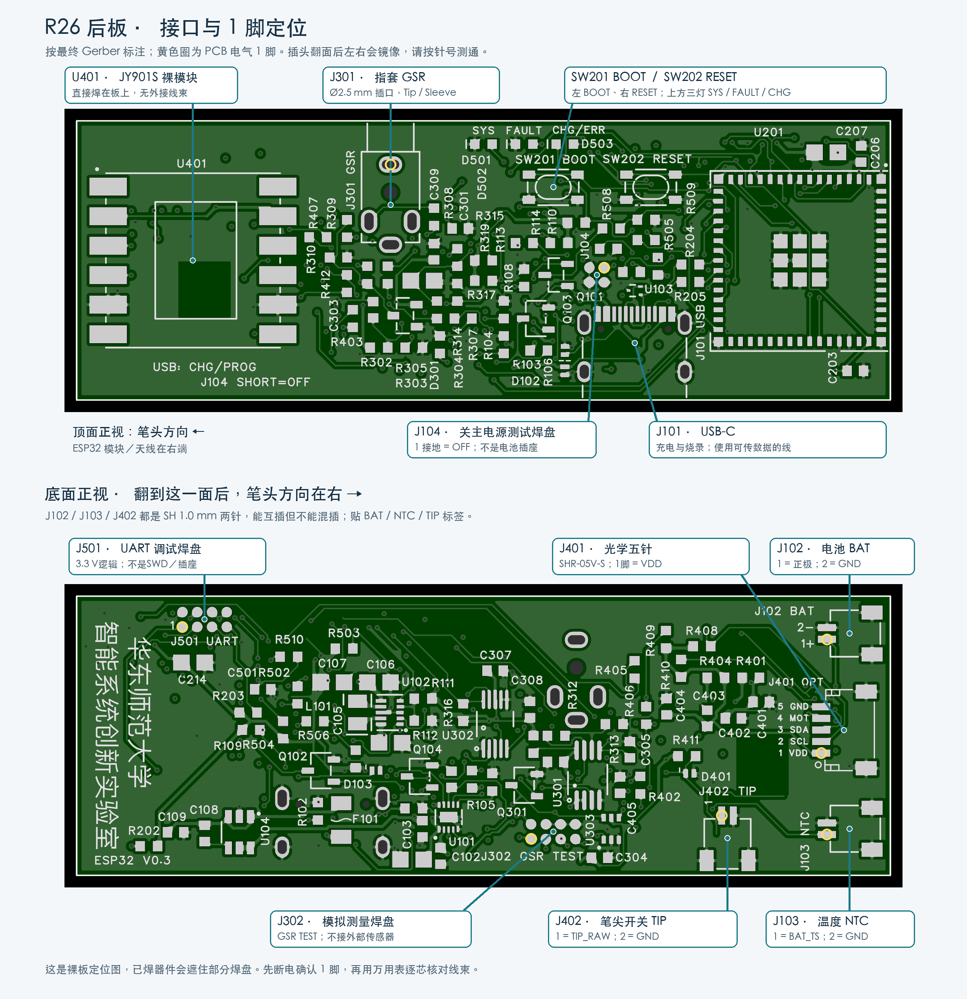
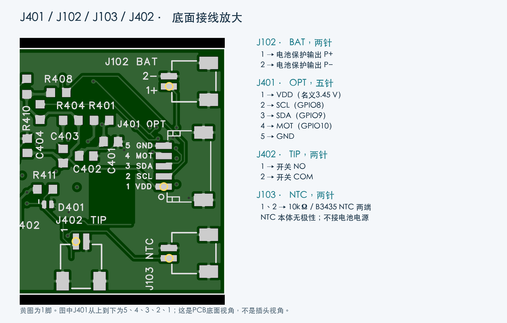
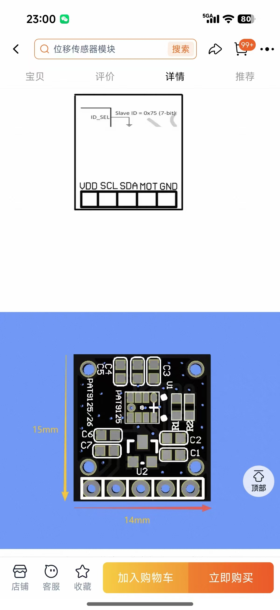

# R26 后板接线、配套插头与外购件说明

> **2026-10-29 机械更新：**已交付[机械v0.5](../mechanical/v0.5/打印与装配说明.md)，适配36×12×6 mm新电池、EVQQ2B03W和现有五芯线（单根外皮外径按≤1.0 mm预留）。下文关于旧v0.4方槽不适配、细线转接及“尚未修改打印模型”的记录保留为历史；当前以v0.5装配说明为准。未修改后板或充电设置，未下单。

> **2026-10-29 最新采购决定：**用户取消光学AWG32细线，计划改壳容纳现有SH1.0 5P成品尾线。本文细线推荐转为旧壳适配备选；J401接线定义不变。改壳尚未交付，要求见[采购清单第11节](补件采购清单_R26.md#11-不买细线改壳适配成品尾线)。

更新：2026-10-29。用户已反馈硬件制作完成。本说明按归档的 **R26 / ESP32-S3-MINI-1-N4R2 / 五针 J401** 后板整理；已逐针核对最终 PCB 的网络、器件型号及原厂连接器规格，未把文件核对当作实物上电测试。

板上可能只印有 `ESP32 V0.3`，没有 R26 字样。最重要的识别点是 **J401 有五个电气触点，旁边依次标 VDD / SCL / SDA / MOT / GND**。历史六针 J401 线序不适用。

> **2026-10-29 采购补充：**具体立创货号、截图尾线选择、SH 带凸缘区别、细线转接材料和 NTC 现货替代候选见[补件采购清单_R26](补件采购清单_R26.md)。原 103AT-4-040 尚未找到现货；替代型号属于待首件验证的采购候选，不表示修改电路或已经测试通过。

## 1. 先买哪些东西

下表数量按一支笔；已经装好的东西不用重复购买。线长是首次试装的建议备料长度，最终沿实际路径裁剪，不是已经验证的装配尺寸。

| 物品 | 应买的型号或明确规格 | 数量 | 用途／购买备注 |
|---|---|---:|---|
| 前端光学成品模块 | **PAT9125EL-TKIT，I²C，14×15 mm，五焊孔 VDD/SCL/SDA/MOT/GND** | 1 | 选此前确认的成品小板，不只买裸芯片；同一商品页不要误选 PAT9126JA-TKIT |
| 光学模块尾线 | **JST SH 1.0 mm、5P、SHR-05V-S 线端胶壳，带压接端子** | 1，建议备 2 | 后板端插 J401，另一端裸线焊光学板；优先 AWG32、单根绝缘外径 0.40～0.45 mm，备约 150 mm |
| 两芯尾线 | **JST SH 1.0 mm、2P、SHR-02V-S 线端胶壳，带压接端子** | 3，建议买 5 | J102 电池、J103 NTC、J402 微动各一根；下面分别说明线径 |
| 电池温度探头 | **SEMITEC 103AT-4-040** | 1 | 10 kΩ±1% @25°C，B25/85=3435 K±1%，引线式；连 J103 并绝缘贴附电芯 |
| 笔尖常开开关 | 无源、瞬时常开，三脚时用 COM/NO | 1 | 现有打印托架按约 3.5×6×6 mm 本体占位，未锁定具体型号；现有开关若能装入并正常触发可继续用 |
| 指套与原线 | 保留原来的两电极指套及 **2.5 mm 插头** | 1 套 | 插 J301，通常无需另买公头；更换插头时按第 6 节接 Tip/Sleeve |
| USB 数据线 | 电脑端接口适配、笔端 **USB-C，支持 USB 2.0 数据** | 1 | 充电、USB Serial/JTAG 烧录；仅充电线不能烧录 |
| JY901S 裸模块 | 已确认的裸模块，直接焊 U401 | 若未装则 1 | 不买带大转接板版本；不需要额外外接线束 |
| 绝缘与固定材料 | 小热缩管、薄绝缘胶带、细软线、可移除固定材料 | 少量 | 单个焊接接头绝缘和应力释放；不要把光学线束缠粗到无法穿槽 |

可直接给线束卖家的描述：

> 需要 JST SH 系列 1.0 mm 间距成品尾线：5P 的 SHR-05V-S 一根，2P 的 SHR-02V-S 三根，均为一端带胶壳及已压接端子、另一端裸线。5P 要 AWG32 多股细软线，每根绝缘外径 0.40～0.45 mm，约150 mm长；电池2P要AWG28，温度和开关2P可AWG30。请确认端子与JST SH兼容，不要PH、ZH、GH或SH1.25；电气针号另按接线表检查。

这里的“公头”按使用习惯理解为**插到板上插座的线端头**。JST 的准确采购名称是 **SHR 线端胶壳＋SSH 母接触端子**；不要只凭商家的“公／母”标题购买。

## 2. 板上位置和插头识别

图来自 R26 实际 Gerber。顶面为元件侧正视、笔头方向在左；底面翻到面前看时，笔头方向在右。图中的黄色小圈标的是**PCB 电气 1 脚焊盘**，不是线端插头正面的左右编号。

| 位号／板上字样 | 接什么 | 已用板端器件 | 配套线端／是否需要插头 |
|---|---|---|---|
| **J101 / USB** | 电脑或 USB 供电 | TYPE-C-31-M-12 | 标准 USB-C 数据线公头 |
| **J102 / BAT** | 单节锂电池电源 | JST SM02B-SRSS-TB(LF)(SN)，C160402 | **SHR-02V-S，2P，SH 1.0 mm** |
| **J103 / NTC** | 贴在电芯上的温度探头 | 同 J102 | **SHR-02V-S，2P，SH 1.0 mm** |
| **J401 / OPT** | PAT9125EL-TKIT 光学小板 | JST SM05B-SRSS-TB(LF)(SN)，C136657 | **SHR-05V-S，5P，SH 1.0 mm** |
| **J402 / TIP** | 笔芯推动的微动／常开开关 | 同 J102 | **SHR-02V-S，2P，SH 1.0 mm** |
| **J301 / GSR** | 原指套电极线 | SJ1-2503A，C4991647 | 原 **Ø2.5 mm 音频形状插头**；不是电源圆孔插头 |
| **J104 / SHORT=OFF** | 主电源关闭测试 | PCB 测试焊盘 | 无预装插座；无需购买插头 |
| **J302 / GSR TEST** | 模拟前端测量 | PCB 测试焊盘 | 无预装插座；测量用探针 |
| **J501 / UART** | 备用串口烧录、EN/BOOT 调试 | PCB 测试焊盘 | 无预装插座；临时细线或测试探针 |

**J102、J103、J402 的插头能互相插进去，但功能完全不同。**每根线贴 `BAT`、`NTC`、`TIP` 标签；尤其不能把电池插入 NTC 或 TIP。

J102/J103/J402 的 3、4 脚及 J401 的 6、7 脚是接地的机械固定焊脚，**不算线束芯数**。

若自行制作压接线：上述 SHR 胶壳配套 **SSH-003T-P0.2-H** 接触端子。原厂规格为 AWG32～28（约0.032～0.08 mm²），绝缘外径0.4～0.8 mm。SHR 型号不含线和金属接触端子，单买胶壳无法使用。前期优先买质量可靠的预压尾线，不必另买微型压接工具。

## 3. J401：光学模块的五根线

已选商品：[PAT9125EL-TKIT / PAT9126JA-TKIT 同页商品](https://item.taobao.com/item.htm?id=965101840300)，应选 **PAT9125EL-TKIT**。链接及14×15 mm尺寸来自此前提供的商品资料，本轮没有确认实时库存或价格。

| 后板 J401 针号 | 板上名称 | 光学模块焊孔 | 后板路径／作用 | 线色建议（仅自行制线时） |
|---:|---|---|---|---|
| **1** | VDD / VOPT | **VDD** | R404=0Ω 接主电源，名义 **3.45 V** | 红 |
| **2** | SCL | **SCL** | R405=47Ω → ESP32 **GPIO8**，I²C时钟 | 黄 |
| **3** | SDA | **SDA** | R406=47Ω → ESP32 **GPIO9**，I²C数据 | 白 |
| **4** | MOT | **MOT** | R407=1kΩ → ESP32 **GPIO10**，运动提示输入 | 蓝 |
| **5** | GND | **GND** | 系统地 | 黑 |

这是按**同名信号一一对应**的五芯线。模块的商品接口图中，标注面文字朝正、焊孔在下方时从左到右为 VDD/SCL/SDA/MOT/GND；看背面会镜像，实物必须按丝印和通断核对。

后板端用 SHR-05V-S 插头；模块端直接焊入五个通孔并固定线根。**模块端只有焊孔，不能直接插 SH 胶壳**。模块孔距尚未正式核实，因此不推荐先买所谓“2.54 mm 双头排线”；若要模块端也可插拔，先测孔距和壳内余量，再选模块端排针／排母。

当前前筒走线槽只按**厚0.5×宽2.4 mm**预留。五根外径0.40～0.45 mm细线并排的宽度约2.0～2.25 mm，比较接近设计；普通AWG28成品线即使能插J401，也可能穿不过前筒。优先买符合外径的AWG32多股细软线，可选薄壁FEP／ETFE绝缘；不要只看“硅胶软线”的名称。

若买不到这么细的预压尾线，可在**后仓内**用短SH尾线分别焊接到五根细线，再用每芯小热缩管独立绝缘，接头错开并做应力释放。穿过前筒的那一段仍保持细线；不要把接头藏进窄槽，也不要用粗总热缩管包住穿槽段。

先备约150 mm，自后仓穿到光学仓后再裁剪；给光学仓角度调节留少量弯曲余量。若带SH头，从后仓把裸线端向前穿，不要强拉插头穿过前筒。

电气上需要保留的区别：

- **VOPT不是独立3.3 V输出。**归档预算约3.389～3.511 V；模块实物应确认输入能覆盖该范围，不能只凭裸芯片允许3.6 V认定成品板电源路径已验证。
- SCL/SDA使用I²C开漏，GPIO8/9；先100 kHz，商品图给的七位地址为`0x75`。R408/R409/R410保持未装，不盲目补装后板上拉；关闭ESP内部上拉，先确认模块自带上拉及其电压。
- 3.3 V逻辑可与本板匹配；1.8 V上拉不能保证被ESP识别，5 V逻辑不能直连。首次接通前测模块电源与空闲信号电平；必要时做适配。
- **MOT是光学运动提示，不是笔尖落笔开关。**首轮可先只接VDD/GND/SCL/SDA并轮询；确认MOT电平和输出方式后再接第4线。
- 以上条件按到货调试核验，不要求为了做线束再次确认此前选型。当前尚无记录证明这块成品模块与实物后板已通电通过。

## 4. J102：电池电源

| 针号 | 网络 | 接线 |
|---:|---|---|
| **1** | VBAT | 带保护板电池的输出正极 P+ |
| **2** | GND | 带保护板电池的输出负极 P− |

线端为SHR-02V-S，建议**AWG28多股线**，绝缘外径0.4～0.8 mm，装配目标长度约50～80 mm；可买100～150 mm尾线再裁短。用电池保护板提供的输出线，不越过保护板直接接裸电芯。

本板按单节3.7 V标称、**4.2 V充满**设计，不接两串电池或4.35 V高压电芯。现有R104对应名义充电约58.8 mA。旧100 mAh电池能否满足新整机的放电峰值仍取决于实测和电芯规格，本说明不改变已确认的ESP32/BLE架构。

**SH电池插头没有统一红黑极性。**先用万用表确认线端接入后“后板1脚为正、2脚为负”，不要根据网店照片、线色或“正反线”名称推断。

## 5. J103：电池温度探头

| 针号 | 网络 | 接线 |
|---:|---|---|
| **1** | BAT_TS | NTC一端 |
| **2** | GND | NTC另一端 |

使用SEMITEC **103AT-4-040**，10 kΩ@25°C、B25/85=3435 K；不是随便一根“10K 3950”探头。NTC本体无极性。配SHR-02V-S，AWG30多股线，建议总长约80～100 mm，实际看电池贴附点到J103的路径。

探头要绝缘贴附在电芯大面，留出本体厚度，不靠后盖压住；不贴在主板上代替电芯测温。R105继续未装，不能用固定10 kΩ电阻假装温度探头。温度方案沿用此前确认，首件实际冷热／开短路停充验证仍按原上电清单执行。

## 6. J402和J301：落笔开关与指套

**2026-10-29 选型补充：**推荐首轮使用松下 **EVQQ2B03W（立创 C79178）**，0.5 N、名义0.2 mm行程、6.5×6.0×3.1 mm；需适配05/06托架及07顶杆，不能直接塞进原6.4 mm方槽。以下通用接线仍有效，历史“具体型号未冻结”仅说明旧打印件按占位制作。详见[采购清单第9节](补件采购清单_R26.md#9-笔尖开关具体型号evqq2b03w)。

**J402：**SHR-02V-S、两根AWG30细软线，建议先备80～100 mm。

| J402针号 | 网络 | 接开关哪里 |
|---:|---|---|
| **1** | TIP_RAW | 建议接 **NO（常开）** |
| **2** | GND | 建议接 **COM（公共端）** |

无源开关的这两端对调电气效果相同；不用NC（常闭）。若是两脚开关，直接接两端；若是四脚轻触开关，先测出按下才接通的一对，不要接到内部本来就相通的两脚。

按下使TIP_RAW接地，经R412=1kΩ到ESP32 GPIO11，读低表示落笔；R411=10kΩ负责上拉。这里不需要额外供电，也不需要另做一块微动PCB。板上SW201和SW202是烧录／复位按钮，不能替代笔芯机械开关。

现有打印方腔约3.9×6.4×6.4 mm，开关本体占位约3.5×6×6 mm，名义活动行程0～0.25 mm；具体开关型号、引脚外伸和触发力未冻结。不能把普通长条鼠标微动按“同为微动”直接当作装壳兼容件；优先试现有小开关，并确认松笔时能可靠复位。

**J301：**直接插保留的指套线。板上为SJ1-2503A，匹配Ø2.5 mm音频形状插头：

| 插头接触区 | 后板连接 | 含义 |
|---|---|---|
| **Tip，最前端金属尖段** | J301-2 / E_TIP | 一只电极 |
| **Sleeve，靠线端的长金属段** | J301-1 / E_SLEEVE | 另一只电极 |
| Ring，中间环（若有） | J301-4，未使用 | 不接电极 |

J301-3为未用的Tip相关触点。若必须新做插头，买**Ø2.5 mm TRS三节、焊接式音频公插头**，仅使用Tip和Sleeve，Ring悬空；这是规格推荐，并未为新的插头外壳冻结某个品牌料号。原有两节TS线可先实测Tip/Sleeve接触；已有线优先原样保留，不要为统一样式剪掉。

新做电极线可用柔软两芯AWG28～30，长度按手指活动范围约0.3～0.5 m；若使用两芯屏蔽线，屏蔽层不算第三只电极，不擅自接到人体电极或系统地。原有线已适配则无需更换。

断电、指套未戴在手上时，测两只电极分别是否通到Tip和Sleeve，且互不短路。**这不是直接测两电极电势差的普通电压表接法**：后板会施加小激励并检测导电变化，两极都经过限流；Sleeve不等于系统GND，不能另拉地线短接。戴指套采集时按原方案用电池和BLE，拔下USB及有线调试连接。

## 7. USB、板上按钮和其余测试焊盘

J101使用标准USB-C数据线。SW201=BOOT（GPIO0），SW202=RESET（EN）；必要时按住BOOT，按放RESET，再释放BOOT进入下载。一般优先用原生USB烧录，J501作为后备。

下面均为**裸测试焊盘**，不需要为正常装配买插头，也不能直接插杜邦母头。J302/J501是1.27 mm中心间距、2×4圆形测试焊盘；不是已装好的2.54 mm排针。

| 测试区 | 实际焊盘定义 | 使用方式 |
|---|---|---|
| **J104** | 1=PWR_EN；2/3/4=GND | 将1脚接地可关闭主系统电源；不是物理断开电池／充电器，不等于适合拆线的完全断电 |
| **J302** | 1=VREF，2=VEX，3=GSR_S，4=GSR_OUT，5=GSR_ADC，6/7/8=GND | 模拟调试探针测量，不接指套或电池 |
| **J501** | 1=UART0_TX(GPIO43)，2=UART0_RX(GPIO44)，3=MCU_EN，4=BOOT_N，5=GND，6=3V45，7/8=GND | USB转串口恢复；**不是SWD** |

USB转串口使用3.3 V逻辑：适配器RX→J501-1、TX→J501-2、GND→J501-5；不要把适配器5 V／3.3 V电源接J501-6，通常板子由自身电池或USB供电。EN/BOOT可用板上按钮操作，不必先接自动下载线。临时线可AWG30～32、尽量不超过约100 mm；测试针需按实际焊盘布局定位，不是任意“6针烧录线”就能用。

U401=JY901S已经直接焊在后板：GPIO17发到模块RX，GPIO18收模块TX；不需另接外部串口线。板上的三颗LED也已经有电路连接，不买外接灯线；SYS/FAULT灯的实际含义由固件定义。

## 8. 一次接对的顺序

1. 断开电池、USB和调试器，先认清J401五针版本以及BAT/NTC/TIP标签。
2. 准备5P光学线和三根2P线，逐针测通；以PCB焊盘1脚为基准，不按插头观察面的左右猜号。先做好光学穿线，再焊模块端。
3. 检查光学模块的输入范围、上拉和实际逻辑电压；先做供电／I²C调试，再接MOT并验证位移。接线定义本身不替代供电兼容确认。
4. 微动接COM/NO并用表测“松开断、按下通”；NTC接J103并贴电池；指套线先测Tip/Sleeve对应关系。
5. 再次实测电池插头极性，完成原有首件上电检查后接J102。两板间及测试线的插拔都先彻底断电。
6. 最后装壳，确认前筒线束不阻碍笔芯、J402弯线使用侧袋、NTC不挤压电池、天线附近无金属或成团线束。

## 9. 核对依据与保留事项

- [本轮逐接口核对记录](wiring_r26/接口核对记录.json)：从R26最终PCB导出读取，包含源SHA256、连接器料号和实际焊盘网络／坐标。
- [R26最终PCB数据](rear_R26/final_pcb.json)、[R26实装BOM](rear_R26/BOM_FIT_REVIEW.csv)。
- [JST SH原厂手册归档](pcb/rear_mainboard/restore_esp32/j401_straight/research/lcsc_SM05B.pdf)：SHR-02V-S／SHR-05V-S、SSH-003T-P0.2-H、AWG32～28和绝缘外径0.4～0.8 mm；[原厂入口](https://www.jst-mfg.com/product/pdf/eng/eSH.pdf)。
- [SJ1-2503A原厂机械图归档](../references/pcb_selection/previews/sj1_2503a_p2.png)：2.5 mm插头和Tip/Sleeve/Ring映射。
- [原光学接入说明](pcb/front_optical/成品模块接入说明.md)、[全部打印件装配说明](../mechanical/v0.5/打印与装配说明.md)、[NTC依据](../docs/KNOWN_ISSUES.md)。

本轮只新增装配／采购说明和接口定位图，未修改后板电路、Gerber、机械模型或核心器件选型。微动实体型号、光学模块到货电平、真实线束长度和实物装壳仍需在已有硬件上确认；上述线材型号与规格不表示已查询实时库存或完成采购。
