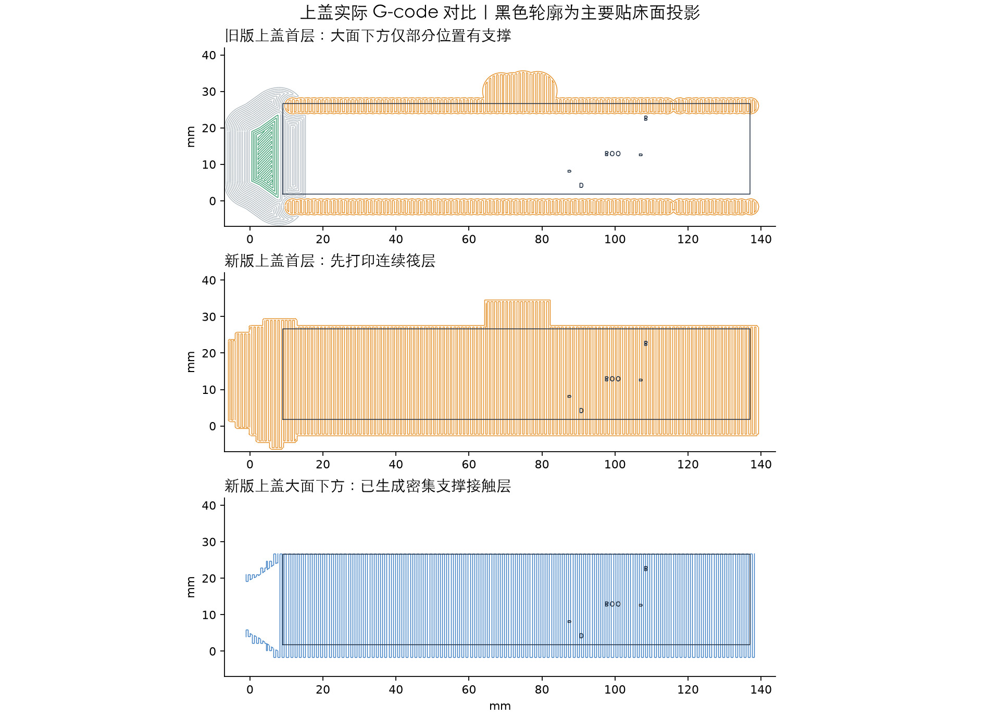
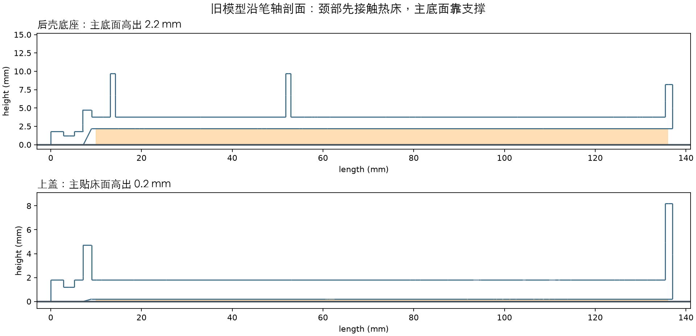

# P1S / PLA：后壳支撑修正与单件验证

2026-10-30。适用 P1S、0.4 mm 喷嘴、普通 PLA、原装金色纹理 PEI。**本版已核查模型和实际出丝路径，尚未经实物打印验证。**不再使用 20261029 的“02_测试通过再打_完整15件”反复尝试。

## 现在打印哪个

按用户最新要求，直接交付 **[完整单盘15件打印文件](手写笔_v05_完整单盘15件_P1S_PLA_支撑修正版.3mf)**，约 **6小时38分、63.31 g**。包含全部外壳件、备用顶杆和4个硬件尺寸替身。打印尺寸不变，采用本次修正的普通支撑和筏层。

单件文件保留供可选补打或排查，不作为使用整盘文件的强制前置条件。清洗后的板仍需干燥放平并调平，观察首层。

在 Bambu Studio 选择“打开项目”，保留随文件保存的机器、耗材与支撑设置，保持100%比例，不自动重新定向。首层打印的是底下的筏层，属于可拆的打印底垫，不是多出来的外壳零件。

1. 用户已重新清洗打印板。确认洗洁精已冲净，板完全干燥，只拿边缘；板底和磁性底座上不能夹有塑料碎屑。
2. 确认选择“纹理 PEI 板”、P1S、0.4 mm喷嘴、PLA，发送时勾选“热床自动调平”。本次没有替你发送打印任务。
3. 观察首层底垫。线应平整连成片，不能卷到喷嘴上、拖动或翘起。底垫不稳就立即停止；不要等后续层“压住”。
4. 底垫正常后，继续观察支撑和上盖大面开始成形时是否脱离。若底垫稳而模型从支撑上脱开，问题在支撑与模型的结合，和底垫从热床脱开不是同一个故障。
5. 完成后等板冷却，取件并分小块拆除底垫和支撑，避开四处卡扣梁。不要把钳子支点放在卡扣薄梁上。上盖外表面为支撑接触面，可能留下纹理；浅刻字清晰度也需实物确认。

**清洗会改善油污导致的附着不良，但不能消除切片中的架空起印。**如果新的平整底垫也在首层被拖走，应继续检查板面、喷嘴残料、调平及挤出，先不要再打整盘。先前五点试片仍可用于检查板面基础附着，不代表外壳支撑已通过。

## 整盘与可选单件文件

| 文件 | 用途 | 切片预估 |
|---|---|---|
| [01_先打_上盖验证_P1S_PLA.3mf](01_先打_上盖验证_P1S_PLA.3mf) | 可选：单独核查或补打上盖 | 1小时33分，15.03 g |
| [02_后壳底座_P1S_PLA.3mf](02_后壳底座_P1S_PLA.3mf) | 单独打印完整后壳底座，用于继续核查/补打 | 1小时49分，18.17 g |
| [手写笔_v05_完整单盘15件_P1S_PLA_支撑修正版.3mf](手写笔_v05_完整单盘15件_P1S_PLA_支撑修正版.3mf) | 用户要求的完整单盘版 | 6小时38分，63.31 g |

已有成功零件不必重打。以上时间包含切片器估计的机器准备，实际会受调平、耗材和机器状态影响。本轮增加了支撑与筏层，整盘比上一版更慢、用料更多；不是为了省时间的配置。

## 查到了什么

用户确认失败的是 20261029 修正整盘，拍照前没有挪动左侧翘起大件。照片能确认大件自行脱离，一些小件仍贴在板上；照片不能还原最早的脱落时刻，也不能独立证明唯一原因。

- **上盖的问题更明显。**前端颈部先贴床，约3120 mm²的主要外表面高出床面0.2 mm。旧 G-code 的首层仅在其投影范围内生成部分支撑；第二层 Z=0.36 mm 已大面积打印桥接线。这里不能按“大平面直接贴床”处理。
- **底座主底面高出床面2.2 mm。**只有颈部约122 mm²直接贴床，3273 mm²主底面依赖支撑。旧文件其实已经在底下生成大面积的支撑根部，不能说它完全没有支撑，也不能说此次失败只是首层接触面积小。
- 后板尺寸替身在原摆放中由凸起器件触床，PCB平面高出最低点5 mm，同样需要充分支撑。

此前检查了装配几何、尺寸和切片是否成功，没有充分检查大平面的起印层和支撑接触层；上一轮仅改温度、速度、附着边及05/06朝向不够。此处补上实际 G-code 层检查，不把切片成功当作打印成功。

## 本轮修改

零件形状、装配尺寸、螺纹、卡扣及电子件位置不变；延续上一轮05/06平面贴床的方向。改为普通网格支撑，增加4层筏层、加密支撑顶部接触层，并降低支撑和后续部分运动速度。

| 参数 | 本版 |
|---|---|
| 层高 / 首层 | 0.16 / 0.20 mm |
| 喷嘴 / 热床 | 220°C；首层65°C，后续60°C |
| 首层速度 / 首层填充 | 15 / 20 mm/s |
| 首层加速度 | 300 mm/s² |
| 辅助风扇 / 模型风扇 | 辅助全程0%；模型风扇前3层关闭 |
| 支撑 | 普通自动、网格样式、基础线距1.5 mm |
| 支撑顶部接触层 | 3层、线间隙0.2 mm |
| 支撑顶面 / 筏层与模型间隙 | 0.2 / 0.2 mm |
| 筏层 | 4层，扩展4 mm，首层密度90% |
| 支撑 / 接触层速度 | 50 / 30 mm/s |
| 壁数 / 填充 | 4圈 / 25% |

支持层可能采用不同层高与错层，打印进度显示的前4个高度不一定刚好等于设置中的4层筏层。以预览和实际出丝为准，不自行把支撑关掉。

## 验证范围

已核查三个文件的嵌入零件尺寸/体积/面数、P1S/PLA/纹理PEI配置、单盘不越界、网格未被自动修补；读取实际G-code，检查首层为筏层、床温及风扇指令、后壳大面下方的接触层，并保存报告。

出丝路径中上盖主面下方已生成连续分布的支撑接触线，和旧版的架空起印不同。但名义线宽的二维覆盖率不等于真实粘接强度，无法远程证明这次一定成功。实际床面、材料挤出、支撑拆除效果、螺纹与卡扣装配仍需实物打印与试装。

装配次序仍按项目的 `mechanical/v0.5/打印与装配说明.md`。20～23为塑料尺寸替身；07/10/11顶杆三选一，不全部装入。
