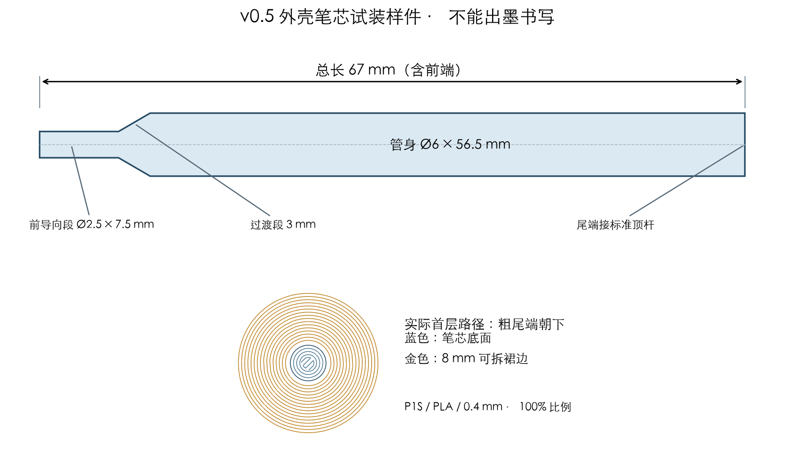

# 67 mm 笔芯试装样件

适用于当前v0.5外壳、EVQQ2B03W微动和07号3.4 mm标准顶杆。建议先以 **67 mm总长（前端最尖处到尾端接触面）**试装；管身参考直径6 mm。这个长度来自当前外壳CAD中的笔芯参考件，不代表所有晨光笔芯都能直接裁成67 mm使用。

**这是塑料尺寸样件，不能出墨书写。**前端Ø2.5 mm是简化导向段，不是0.5 mm圆珠；模型不复刻尚未提供确切型号的晨光笔芯内部结构。

## 打印哪个

优先打开 **[笔芯样件_67mm_P1S_PLA.3mf](笔芯样件_67mm_P1S_PLA.3mf)**，选择“打开项目”，保留设置。只有一根笔芯，不需要重打外壳。已切片，预计约 **56分钟、2.16 g PLA**，包括打印机准备及裙边，未发送打印。

- [独立STL](笔芯样件_67mm_尾端朝下.stl)：需要自行设置切片时使用，单位mm。
- [STEP尺寸模型](笔芯样件_67mm_装配坐标.step)：供修改或检查，沿用外壳装配坐标。
- 保持100%比例，不要自动重新朝向或统一缩放。

| 参数 | 已设定 |
|---|---|
| 机器 / 喷嘴 / 材料 | P1S / 0.4 mm / PLA |
| 打印板 | 原装金色纹理PEI |
| 方向 | Ø6 mm粗尾端贴床，细前端朝上 |
| 层高 / 首层 | 0.16 / 0.20 mm |
| 墙数 / 填充 | 4圈 / 25% Gyroid，细前端由墙线填实 |
| 支撑 / 筏层 | 不需要，均关闭 |
| 裙边 | 外侧8 mm，间隙0.08 mm，完成后拆除 |
| 喷嘴 / 热床 | 220°C；热床首层65°C，后续60°C |
| 首层 / 外墙速度 | 15 / 25 mm/s |
| 加速度 | 默认500 mm/s²，外墙400 mm/s² |
| 辅助风扇 | 打印模型期间关闭；模型风扇前3层关闭 |

先前存在首层附着失败，因此这次使用粗尾端贴床、加宽裙边、较低速度和加速度。清洁干燥打印板、保持自动调平，并观察首层圆形裙边是否粘住。若首层仍被拖走就停止；切片检查不能证明实物附着已解决。

打印后冷却取下，拆除裙边，只清理尾端边缘毛刺，避免把尾部磨短。用卡尺核对总长与直径；CAD为67.00 mm，当前切片最高层为67.08 mm，实际还受挤出、首层与收缩影响。试装前消除接缝凸点，不能把紧配卡住误判为长度不对。

## 尺寸和为什么选67 mm

| 部分 | 尺寸 |
|---|---|
| 总长 | 67 mm |
| 管身 | Ø6 × 56.5 mm |
| 前端过渡 | 长3 mm，Ø2.5渐变到Ø6 |
| 前导向段 | Ø2.5 × 7.5 mm |

当前模型的笔芯前端位于笔轴X=0、尾端X=67；标准顶杆朝笔芯的接触面也位于X=67。笔筒前导向孔为Ø6.6、尖端出口为Ø3.2，为样件保留滑动间隙。已对现有01/02/05/06的STEP实体复核：参考位置及向后0.20/0.30 mm的运动位置无实体干涉。

参考笔芯在笔头内还有约0.5 mm的向前自由量，前端伸出约4.5～5.0 mm；这说明总长不是唯一决定因素，**真实笔芯前部台肩形状也会影响伸出量和空行程**。样件保留现有参考外形用于核对，不将这一结果写成已确认的最佳书写手感。

## 如何试装

1. 使用真实微动、05/06托架和07标准顶杆；23号塑料微动替身没有回弹，不能做触发测试。07顶杆宽盘朝笔芯、细柱朝微动。
2. 断电，旋下02号笔头，将样件**粗尾端先**从前方插入01号笔筒，尾端抵到顶杆；再套上并轻轻旋合笔头。已有笔芯先取出，不能叠装。
3. 不接电时确认样件能轻推后退，松手能回位。不要通过强拧笔头迫使开关触发。
4. 接USB，使用[微动测试程序](../../../firmware/Tip_R26_Test/Tip_R26_Test.ino)。当前故障电池仍保持断开。
5. 静止时应为`TIP:0`、SYS灯灭；轻压样件前端应为`TIP:1`、SYS灯亮；松手恢复为0。持续按住只计一次。
6. 若静止就触发，先排除卡滞/装配不到位，再尝试已有10号3.2 mm短顶杆；若到止挡仍不能触发，再尝试11号3.6 mm长顶杆。三根只装一根，每次都重新验证释放状态。

塑料笔尖只用于轻压测试，不适合在纸面上长时间摩擦，也不能代替正式书写笔芯。

## 真实笔芯怎么处理

先用这根样件确认长度和机构，再比较真实笔芯的管身直径、金属尖端、前部台肩和尾端。最终目标为“旋紧笔头后松开不触发，轻压触发且能自行复位”。型号和前端形状不同时，不能仅按总长复制。

**不要直接剪断仍有墨水或尾油的部位。**若普通长芯在67 mm位置仍有墨柱，改用合适短芯或等明确供墨结构后另行处理，不能通过随意截墨管获得可靠短芯。

## 验证范围

已检查单一CAD实体有效性、封闭STL网格、6×6×67 mm包络、与当前外壳的几何配合，以及3MF内尺寸/朝向/设置和实际首层路径；无自动网格修补，只有1件参与打印。模型与切片检查通过，未实物打印，未验证实际笔芯、开关公差、回弹及书写手感。详细记录见`reports/geometry.json`与`reports/print_validation.json`。
