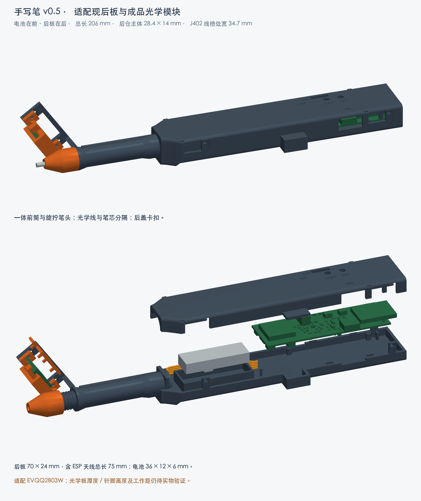
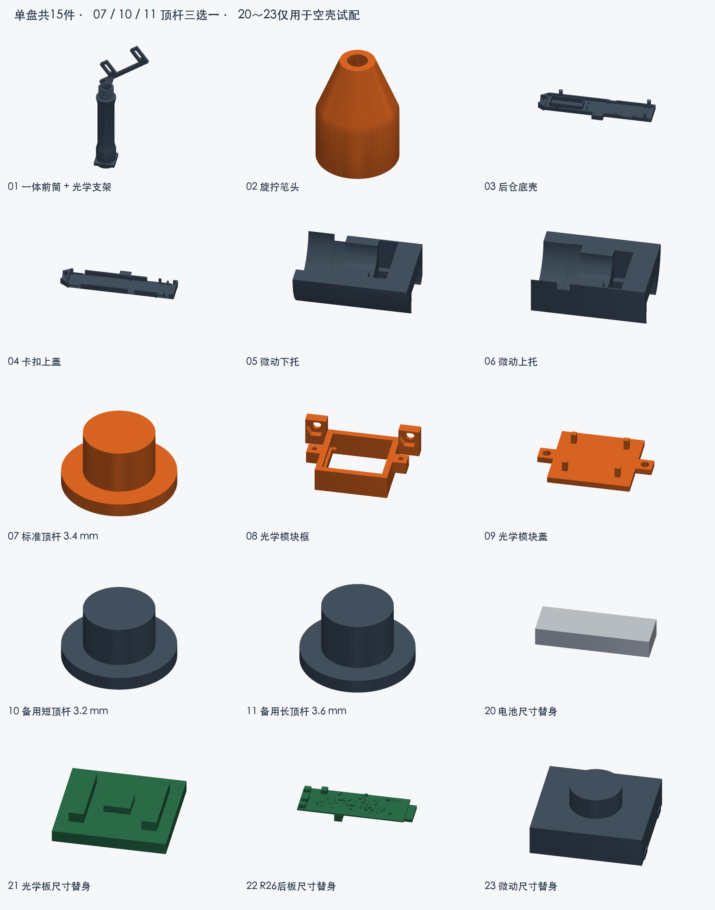
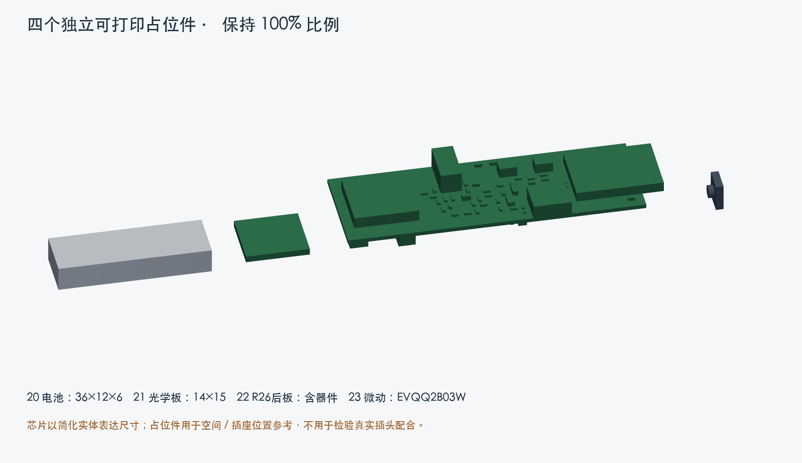
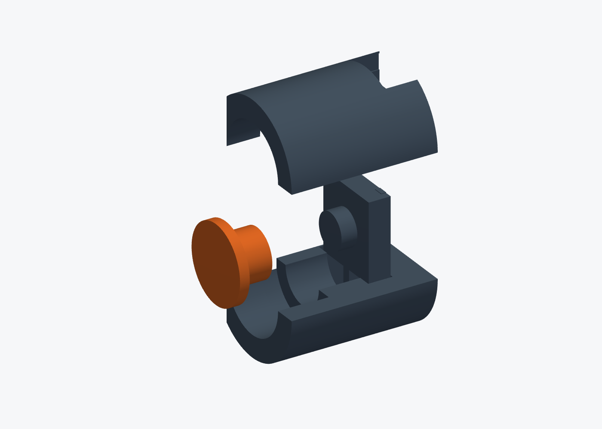
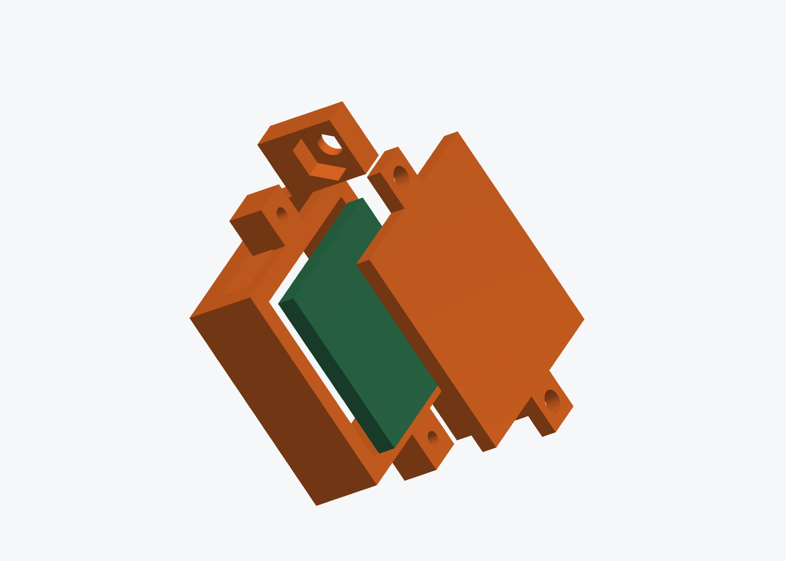
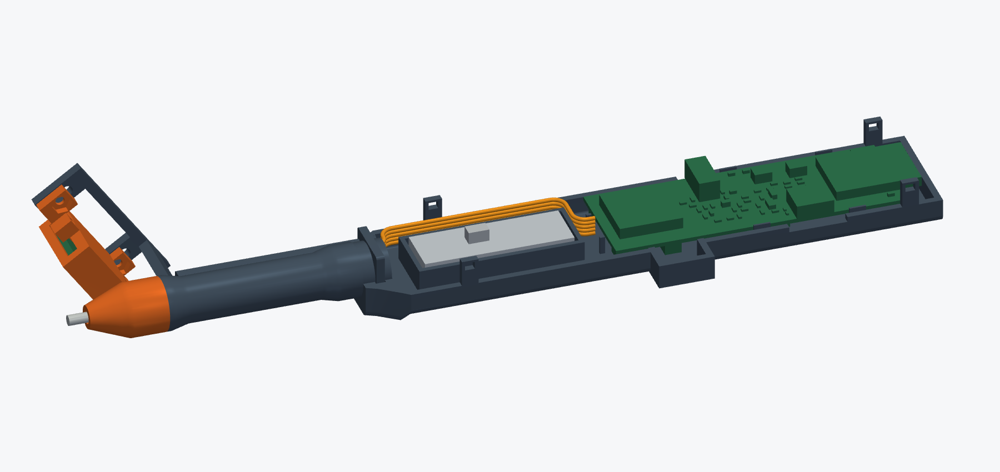

# 手写笔 v0.5：36×12×6 电池 / R26 后板 / EVQQ2B03W

> **2026-11-03 笔芯试装补充：**新增[67 mm笔芯打印样件及说明](refill_dummy_20261103/打印与试装说明.md)，用于确认前筒滑动、伸出量与真实微动触发，不需要重打整套外壳。它是不能出墨的尺寸样件，真实笔芯最终长度仍须结合前部台肩和装配公差确认。

> **2026-10-30 打印入口更新：**20261029修正整盘再次失败。按用户要求直接用[新版完整单盘15件3MF](print_support_fix_20261030/手写笔_v05_完整单盘15件_P1S_PLA_支撑修正版.3mf)；[使用说明](print_support_fix_20261030/先看这里.md)。本说明的零件与装配尺寸仍有效；下方原版切片参数及时间仅保留供对照。新版尺寸不变，实物验证待完成。

2026-10-29。单位均为毫米。适用拓竹 P1S、0.4 mm 喷嘴、PLA。此版为可打印的实物适配原型；旧 v0.4 保留作历史，不混用旧微动托架、旧顶杆或旧后壳。

## 1. 打印哪个文件

**原 `v05_all_parts_P1S_PLA_prepared.3mf` 已停止推荐，请使用上方20261030新入口。**一盘15个对象：外壳机构9件、备用顶杆2件、电子件尺寸占位模型4件。按层打印，全部保持100%比例，不重新自动朝向，不合并成一个实体。

- `v05_all_parts_geometry_mm.3mf`：同一套模型，仅几何；给其他切片器使用，需自行设置打印参数。
- `v05_shell_geometry_mm.3mf`：9件外壳机构及2根备用顶杆，仅几何。
- `v05_hardware_dummies_geometry_mm.3mf`：仅4个塑料占位件。
- `stl/`：历史独立STL，不能直接沿用旧摆放和支撑补打；优先使用新版带设置的3MF。
- `cad/smart_pen_v05_assembly_mm.step`：装配状态的CAD，用于查看和修改，不是整件一体打印。
- `cad/reference_wire_route_NOT_FOR_PRINT.step`：检查用线束，不能打印代替导线。

**20～23是塑料尺寸替身，不是电子器件。正式装配时取出，用真实电池、模块和微动替换。07、10、11三根顶杆只选一根装入。**

切片预计 **4小时34分钟、49.04 g PLA**（含占位件、支撑和裙边，实际随耗材校准及机器状态变化）。

## 2. 本轮尺寸依据与预留

| 项目 | 建模尺寸/处理 | 依据与边界 |
|---|---|---|
| 电池 | 36×12×6；仓内长37.6、宽13.0，底部留0.5软垫 | 用户最新商品图标注；按包含保护板的总尺寸处理，尚非卡尺实测。型号印字601235不替代图上36 mm总长 |
| 电池位置 | 在后板前方，长边沿笔轴；不叠放在PCB下面 | 延续用户偏好的薄仓方案；保护板出线端朝后板，线放入前端接插件空间 |
| 后板 | FR4 70×24×1.0；含天线长75 | 按R26最终PCB重新读取全部器件位置；板厚1.0为原制板目标，焊锡高度未实测 |
| 后板尺寸替身 | 外包络75×24.55×8.9 | 含两面器件及插座突出，不把裸板尺寸当装配包络。小器件为简化保守实体 |
| JY901S、ESP32 | 随后板尺寸替身体现 | JY901S 15.24×15.24×2.8；ESP32-S3-MINI-1 20.5×15.4×2.4，均按名义外形 |
| 光学成品板 | PAT9125EL-TKIT，外框14×15，板厚暂按1.6 | 外框来自此前商品资料；芯片/器件位置与高度仍简化，采用平贴焊线，不能容纳未核实高度的直立排针 |
| 笔尖轻触开关 | 松下EVQQ2B03W，本体6.5×6.0，含按钮高3.1±0.2 | 原厂图纸；J形脚最大约6.6另留焊线槽，非普通6×6大力度替代品 |
| 开关方腔 | 横向6.5×7.0；轴向本体空间2.0，按钮单独让空 | 6.0边沿Y、6.5边沿Z，按钮朝笔尖，后部承力面支撑开关本体 |
| 五芯光学线 | 通道净截面1.3×5.5；五根每根绝缘外径≤1.0并排 | AWG只表示铜导体粗细，外皮直径未实测；不是直径5 mm圆线束，也不允许热缩接头塞入槽内 |
| 笔芯 | 塑料管参考Ø6，前导向Ø6.6，尖端出口Ø3.2 | 普通晨光黑色水笔芯无确切SKU及实测长度；67 mm为参考总长，不能据此直接截断满墨笔芯 |

整笔参考总长约 **206 mm**（含参考笔尖）；后仓主体 **28.4×14 mm**，J402局部接线凸袋处总宽 **34.7 mm**。微动连接颈部局部高度约16.4 mm。握持圆筒主体仍为Ø11，独立线槽一侧局部加厚后横向最大约12.25；靠笔头肩部及微动座有局部加粗，光学支架单独向侧方伸出。

电池比旧版长15 mm；本版总长增加18 mm，余量用于新电池、端部和走线。电池标注300 mAh只记入机械输入，本轮未修改PCB充电设置或推断其允许放电电流。

## 3. 打印参数

| 参数 | 本版设置 |
|---|---|
| 机型/喷嘴/材料 | Bambu Lab P1S / 0.4 mm / Generic PLA |
| 层高 | 0.16 mm；首层0.20 mm |
| 墙层 | 4 |
| 顶/底层 | 5 / 5 |
| 填充 | 25%，Gyroid螺旋体 |
| 支撑 | 自动树状，仅从热床生成；阈值35°；上下接触间距0.20 mm |
| 外侧裙边 | 5 mm，模型间隙0.10 mm |
| 打印顺序 | 按层，不逐件打印 |
| 温度 | 以工程内PLA设置与自己的耗材匹配；默认喷嘴220°C、纹理PEI热床55°C，最终设置见切片验证报告 |
| 尺寸 | 100%，不要统一放大缩小补偿 |

前筒已竖放；顶杆大圆盘贴床。保留预设摆放，清掉可拆支撑后检查公母螺纹、开关腔、线槽入口与尾端是否通畅。不要将支撑残渣误当限位件。打印后先用占位件装空壳，再装真电子件。后盖卡扣属于PLA弹片，几何通过不等于反复开合寿命已经验证。

## 4. 全部15个打印件

| 编号/文件前缀 | 名称 | 用途/装入数量 |
|---|---|---|
| 01 | 一体前笔筒 | 握持、笔芯导向、公螺纹、独立线槽、光学双长孔支架；1件 |
| 02 | 母螺纹锥形笔头 | 前端换笔芯，旋在01公牙上；1件 |
| 03 | 后仓底壳 | 电池围栏、后板边缘支撑、接口避让、卡扣接收框；1件 |
| 04 | 后仓上盖 | 四处释放卡扣、BOOT/RST操作孔、LED及接口开口；1件 |
| 05 | 微动下托 | 开关与顶杆的下半固定座；1件 |
| 06 | 微动上托 | 和05合拢，从01尾部装入；1件 |
| 07 | 标准顶杆，长3.4 | 宽盘朝笔芯、细柱朝开关；先试这一根 |
| 08 | 光学模块小框 | 窗口朝纸，边角支撑光学板，侧耳固定在01支架；1件 |
| 09 | 光学模块盖 | 盖板背面，四个小压脚朝内；1件 |
| 10 | 短顶杆，长3.2 | 07导致开关预压时替换，不能与07叠装 |
| 11 | 长顶杆，长3.6 | 07间隙过大导致不触发时试换，不能与07叠装 |
| 20 | 电池替身36×12×6 | 空壳检查用，装真电池前取出 |
| 21 | 光学板替身14×15 | 检查外框/安装方向；不能检验镜头工作距 |
| 22 | R26后板替身 | 核对整体包络、接口和卡扣；不能替代真实插头试插 |
| 23 | EVQQ2B03W替身 | 检查开关外形；没有触点或回弹，不能用它测试落笔触发 |

## 5. 装配前准备

保留现有后板、成品光学板、带保护电池、EVQQ2B03W、笔芯、五芯及两芯SH尾线、指套。另用：M2×6螺丝2颗及M2螺母2颗；M1.6×3螺丝2颗（头外径≤3.2）；约0.5 mm绝缘软垫、薄聚酰亚胺胶带、细热缩管。已有NTC按接线说明接J103，探头绝缘贴在电池外表面，仓内预留了顶部空间。

焊接线头、去毛刺和热缩在电子件装壳前完成。裸露焊点逐个绝缘；真实电池不能当作压入尺寸不合适仓体的试块。应以塑料占位件先试配，真电池正常放入后仍应有余量。

## 6. 穿光学线：先穿线，再装微动

1. 01内部大孔只放笔芯。旁边细长矩形通道放光学五线，中间有约0.8 mm塑料隔壁，不能把五线塞入笔芯活动区。
2. 将五根线整理为单层并排；可在尾部暂做标记。SH五针插头留在后仓一端，从01尾端把五根没有大接头的线端送入矩形通道，经前侧开口引出。必要时用引线牵引，不强拉已焊好的模块。
3. 大SH插头、热缩接头、焊线团不能穿进1.3 mm厚的通道。若线外径超过1.0 mm，先停止穿线核对尺寸；不能剥掉长段绝缘强塞。
4. 前端引出线沿光学支架内侧，留可调节的小弯曲余量，再穿08的长条出线窗，与成品光学板五孔按信号名焊接。线贴板背走，避免竖直排针增加厚度。
5. 后端五线沿电池靠光学/GSR一侧的空隙绕过电池，进入后板前端J401。检查模型包含五根Ø1 mm线、中心弯曲半径3 mm的路线；实际软线自然圆弯，不能折出尖角或压在卡扣下。
6. 连接器最终分线、焊点和热缩依实物整理，检查用线束实体没有模拟最后每个压接脚。用薄胶带固定外露光学段，不遮窗口、不牵拉传感器焊点。

J401顺序：1 VDD、2 SCL、3 SDA、4 MOT、5 GND。不要只按线色。详细电气接线见项目硬件接线说明。

## 7. 微动、顶杆与笔芯

1. 将真实EVQQ2B03W的6.0 mm边横放、6.5 mm边竖放，按钮朝笔尖。不要按“同边/对角”猜脚位：用万用表找静止断开、按下导通的一对A/B触点，接J402的两根线。引线优先从开关上方的槽向尾部走，两根线各自绝缘。
2. 05凹面朝上，07宽盘放前方大圆腔，细柱朝后。再放入微动，让开关背面落到托架后方的实体支撑面，别让焊点承受笔芯推力。
3. 合上06。两半无独立卡扣，靠01套住。将组合件的圆形前端先送入01尾部；05/06被削平的那一侧朝光学线槽。到位后托架后端与01尾端齐平。
4. 将笔芯从前端放入，笔芯尾部顶到顶杆宽盘，旋上02直到肩部轻轻贴合。螺纹为自定义右旋，螺距1.6，公牙在01上。笔芯必须能做少量轴向移动，不能被笔头孔或走线卡住。
5. 先在未接电时用万用表验证：松开笔尖应断开；轻压应接通；松手应恢复。微动名义动作行程0.2 mm，机构塑料止挡行程0.30 mm。H=3.1±0.2及打印公差使理论0.10 mm余量不能当作实测保证。
6. 若标准07在静止时就压住开关，试较短10；若间隙太大、顶到止挡还不导通，试较长11。三根的盘厚相同，只调整柱端长度。三根外观相似，按盘内对象名分开放置或用卡尺测总长区分。更换后必须重新检查松开/触发/回弹。若都不合适，记录尺寸再调整，不靠强拧笔头或塞硬垫把开关持续压下。
7. 顶杆宽盘碰托架台肩后，应由塑料止挡承受继续施加的力；不能使开关成为承受重压的终点。设计提供限位，但仍须实物确认先触发、后止挡，并核实实际开关可接受的压入量。

没有额外弹簧，正常回位依赖真实微动自身回弹及笔芯顺畅滑动。塑料23没有弹性，空壳试装不会自动回弹。03/04合壳后尾端肩部才阻止微动托架后退。

笔芯参考总长67 mm尚未针对某个晨光SKU实测。先比对笔尖位置及后端余量，不能把带墨长芯直接按67 mm截断；墨柱未避开切口的笔芯不适合直接剪短。

## 8. 光学框、窗口及调节

1. 08大开口朝纸；成品板镜头/感应面朝开口，板边落四角台阶。09盖在板背，四个小压脚朝内，不能把盖装在镜头前面。
2. 09用两颗M1.6×3穿过Ø1.9通孔，拧入08的Ø1.3塑料底孔。轻手预制/攻入；不要把耳朵拧白。按1.6 mm板厚，压脚约留0.25 mm，可薄软垫止晃，不能用厚胶带硬挤元件。
3. M2螺母放08耳朵的六角窝；螺钉从01长孔架外侧向内，穿长孔、08圆孔，拧入螺母。两边同时松装，调整后交替轻紧。
4. 开口尺寸15.6×14.6，中央光路没有透明片或塑料挡住。四角小台阶承托板边，不让芯片承重。
5. 沿用55°笔身对纸基准，对应光学轴线与笔轴约35°；光学板感应面名义平行纸面。窗口框下缘对参考纸面约6.5，PCB朝纸面约8.5，简化芯片前面约7.5 mm。这是装配基准，不是已经确认的最佳光学工作距。
6. 长孔及圆孔提供位置/倾角调整，几何检查覆盖高度±1 mm、倾角±7°。真实板镜头、焊线和纸面必须一起验证：笔芯能落纸、框不刮纸，模块能稳定输出平面位移。不要以塑料替身代替光学验证。

## 9. 电池、后板及合盖

1. 03放平，电池围栏底部垫约0.5 mm柔软绝缘垫。先放20试配，再换真电池。电池保护板及线头朝后板，不能折保护板或挤压电池。固定带槽可穿薄绝缘带，贴合即可，不勒紧软包。
2. NTC绝缘贴附电池外表面，线走旁边，接J103。不要把探头夹在硬底壳和电池之间；顶部预留空间用于探头及薄绝缘层。保持后盖闭合后不压探头/电池。
3. 后板先接好底面J401/J102/J103/J402，再从上方落入03四处边缘支撑。ESP32天线朝尾端，JY901S靠电池，USB-C朝USB孔、指套座朝GSR孔。板边承力，不将器件压在底壳上。天线末端不塞导线或金属物。
4. J402朝侧方，03/04侧面凸出的“小盒子”是它的插头及两根线的回弯空间；不能削掉，也不是另一块电池仓。
5. 把01异形尾圈从上方放入03前端凹槽，不是硬塞进闭合后的圆孔。异形圈同时防转和防脱。此时微动托架尾部由后壳肩部顶住。
6. 按线名确认：J102电池、J103温度探头、J402笔尖开关，三个2P外形相同不能互换。电池接线极性核实后再连接；此处仅说明装配，电气验收按原后板清单执行。
7. 对好04的导轨，检查线不在边缝、卡扣和按钮下面，轻压前后两组共四处卡扣。USB、指套插头应能插到底，不应顶着壳体而半插。上盖BOOT/RST是操作通孔，用细绝缘棒按板上键，没有漏印的按钮帽。
8. 打开时，用窄塑料片经侧面小窗朝内按钩头，逐组释放并轻提盖。不要在另一端仍扣住时大角度掰盖；不要把工具伸到电路板上。先断开电池，再做内部拆装。

## 10. 验证记录与使用边界

模型检查报告保存在 `reports/`：实体有效性/封闭网格、装配碰撞、插入路径、螺纹旋出、顶杆止挡、前筒线束、后板接插件避空、光路及颈部壁厚，以及P1S切片一致性。结论仅对建模尺寸与理想几何有效，不替代实物打印、公差、书写手感和光学追踪测试。

这次优先做到了可打印和按已知模块尺寸装配。仍需实物确认的项目：光学板厚度与焊线高度、五根导线外皮直径、实际板厚/焊点高度、电池带保护板的总尺寸、准确笔芯长度、PLA卡扣与螺纹配合、微动触发/回弹以及实际纸面光学距离。

图纸依据：用户电池截图 `reference/battery_36x12x6_user.jpg`；包内 `reference/EVQQ2B03W_dimensions.pdf` 第3页EVQQ2B03W外形；R26 `final_pcb.json` 与原生封装。未修改后板或原理图，未向打印机发送任务。
